  

  Software engineer and security researcher at DTU, New Delhi. 
  Building at the intersection of AI, security and developer tooling.

  
  
  
  

 

## Now

- Fullstack engineer at a stealth startup, building an AI-driven security monitoring platform.
- President of [EHAX](https://github.com/E-HAX), the DTU cybersecurity club. We ran EHAX CTF for 3,000+ players.

## Selected work

- [**corvus**](https://github.com/tusharsinghbisht/corvus): AI SOC agent. Links detections to evidence and drafts cited, human-reviewed triage reports. Wazuh first.
- [**altqueue**](https://github.com/tusharsinghbisht/altqueue): durable task queue in Go with gRPC, leases, retries, delayed jobs and dead-lettering.
- [**dockerpulse**](https://github.com/tusharsinghbisht/dockerpulse): Docker metrics, logs and events in one dashboard.
- [**agentscan-ai**](https://0xbenzo.dev/projects/agentscan-ai): static scanner for indirect prompt injection and unsafe tool definitions in LangGraph systems.
- [**microcache**](https://0xbenzo.dev/projects/microcache): single-binary key-value store in Go with replication.
- [**victor-ctfd**](https://github.com/E-HAX/victor-ctfd): CTFd theme built for EHAX CTF.
- [**wmatrix**](https://github.com/tusharsinghbisht/wmatrix): Matrix digital rain for the terminal, on Windows and Linux.

More: <a href="https://0xbenzo.dev/projects">all projects</a> · <a href="https://0xbenzo.dev/blog">blog</a> · <a href="https://github.com/tusharsinghbisht/ctf-writeups">CTF writeups</a> · <a href="https://github.com/tusharsinghbisht/ropemporium">ROP Emporium</a> · <a href="https://github.com/tusharsinghbisht/windots">windots</a>

 

## Stack

  

