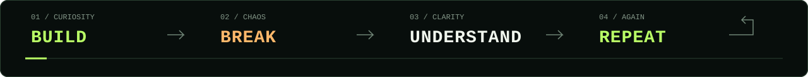

<p align="center">
  
</p>

<h1 align="center">Tushar Singh Bisht <sub>aka benzo</sub></h1>

<p align="center">
  <strong>I build things. I break things. I figure out why.</strong><br />
  Software engineer · DTU student · CTF player<br />
  Usually somewhere between an AI agent, a packet capture, and a terminal.
</p>

<p align="center">
  <a href="https://0xbenzo.dev"><strong>0xbenzo.dev ↗</strong></a>
  &nbsp; / &nbsp;
  <a href="https://linkedin.com/in/tusharsinghbisht">LinkedIn</a>
  &nbsp; / &nbsp;
  <a href="https://x.com/b3n_zo">X</a>
  &nbsp; / &nbsp;
  <a href="mailto:aabisht2006@gmail.com">Email</a>
</p>

---

## `01` / The operator

```toml
[benzo]
base = "New Delhi, India"
campus = "Delhi Technological University"
focus = ["security × AI", "cloud infrastructure", "developer tools"]
side_quests = ["CTFs", "terminal rabbit holes", "technical writing"]
default_question = "what happens if I try this?"
```

I'm interested in the messy parts: noisy security alerts, systems that need observability, and AI that has to do more than look impressive in a demo. I build tools to explore those problems, from security workflows to prompt-driven video editing.

## `02` / Things that escaped the terminal

<table>
<tr>
<td width="50%" valign="top">

### 🐦 [Corvus](https://github.com/tusharsinghbisht/corvus)

**Find the signal in the security noise.**

An AI correlation engine for Suricata and Zeek workflows. Connecting events across network logs to help surface threats and anomalies.

<sub>AI · NETWORK SECURITY · ALERT CORRELATION</sub>

</td>
<td width="50%" valign="top">

### 📡 [DockerPulse](https://github.com/tusharsinghbisht/dockerpulse)

**Your containers have something to say.**

Real-time Docker observability: metrics, streaming logs, events, and health status in one dashboard.

<sub>GO · NEXT.JS · OPENTELEMETRY · CLICKHOUSE</sub>

</td>
</tr>
<tr>
<td width="50%" valign="top">

### 🍝 [Pastify](https://github.com/tusharsinghbisht/pastify)

**What if I built the framework myself?**

A lightweight, Flask-inspired Python web framework built on sockets. Routing, HTTP parsing, middleware, static files, and templating—built to understand what happens under the hood.

<sub>PYTHON · SOCKETS · HTTP · WEB FRAMEWORK</sub>

</td>
<td width="50%" valign="top">

### 🎬 [Clumsy](https://github.com/tusharsinghbisht/clumsy)

**Video editing, compiled.**

Turns a prompt into an editable JSON timeline, then compiles it into an MP4 using your own footage. Beat-synced cuts and shot-level indexing included.

<sub>AI · FFMPEG · TIMELINE COMPILER</sub>

</td>
</tr>
</table>

<details>
<summary><strong>Open the side-quest inventory ↴</strong></summary>

<br />

- **[CTF writeups](https://github.com/tusharsinghbisht/ctf-writeups)** — notes from the other side of the challenge.
- **[ROP Emporium](https://github.com/tusharsinghbisht/ropemporium)** — working through return-oriented programming challenges.
- **[IGDTUW 3D](https://github.com/tusharsinghbisht/IGDTUW-3D)** — a team-built campus map with Three.js, WebGL, and interactive navigation.
- **[windots](https://github.com/tusharsinghbisht/windots)** — because the environment is part of the project.

</details>

## `03` / What's on the bench

- **Security × AI:** building security tooling, exploring agentic systems and RAG, and integrating SIEM workflows.
- **Systems:** learning Kubernetes and distributed systems; making infrastructure easier to inspect.
- **Curiosity:** CTF challenges, technical blogs, and small experiments that grow legs.

## `04` / The toolbox

| Layer | Tools I work with |
| :--- | :--- |
| **Languages** | Python · TypeScript / JavaScript · Go · C / C++ |
| **Backend & data** | Node.js · Express · FastAPI · Flask · PostgreSQL · MongoDB · Redis |
| **Interfaces** | React · Next.js · Astro · Tailwind CSS |
| **AI systems** | LLMs · RAG · AI agents · Multi-agent systems |
| **Infrastructure** | Docker · Kubernetes · AWS · Cloudflare · Nginx |

---

<p align="center">
  <a href="https://0xbenzo.dev">
    
  </a>
</p>

<p align="center">
  <sub>Interesting systems. Strange bugs. Good conversations.</sub><br />
  <strong><a href="mailto:aabisht2006@gmail.com">Send me a signal ↗</a></strong>
</p>
